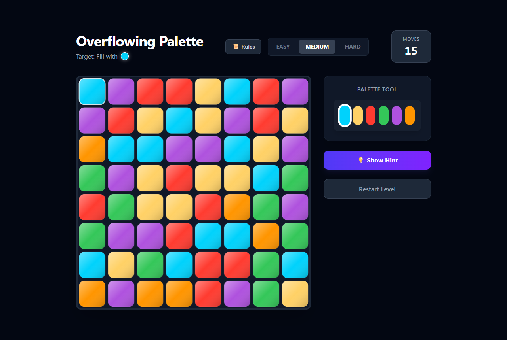
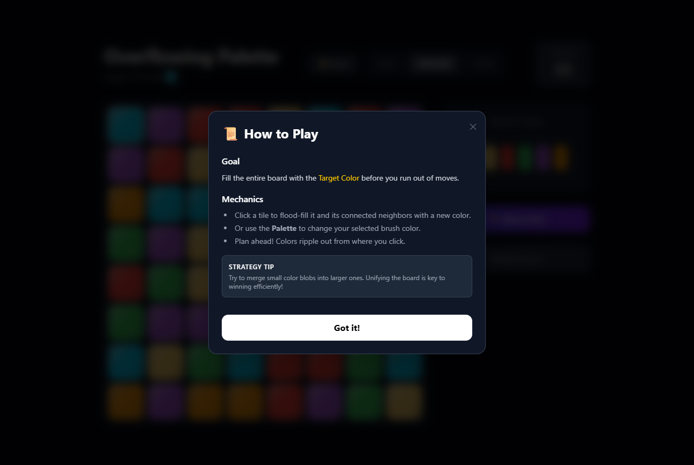
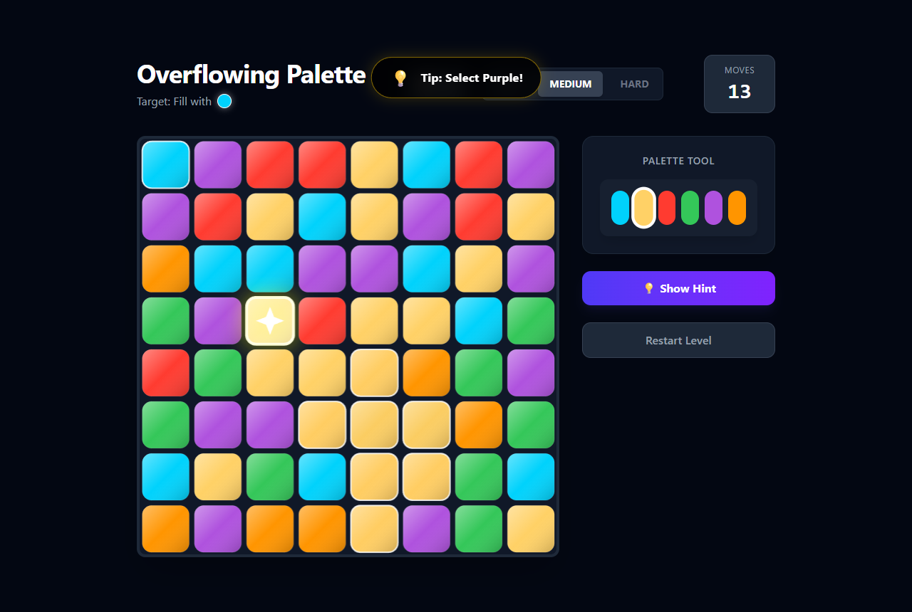
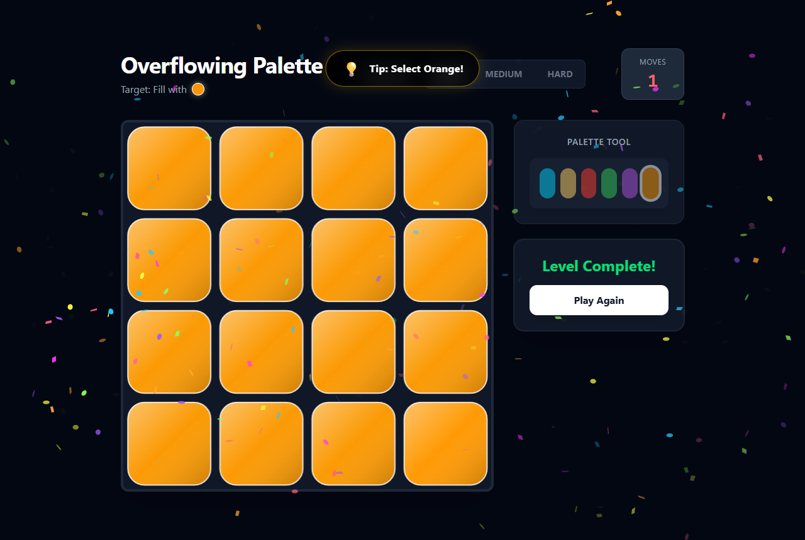

# Overflowing Palette

A small colour flood puzzle for the browser. You get a board of coloured tiles and a target colour, and you have to turn the whole board into that colour before you run out of moves.

This was my first project made with Google Antigravity, and it was built completely with AI.



## How it works

Pick a colour from the palette, then click a tile. That tile and every tile of the same colour connected to it change to the new colour, and the change ripples out from where you clicked. Each click uses one move. Merge small patches into bigger ones and work towards the target colour shown under the title.

There are three levels:

| Level | Board |
|---|---|
| Easy | 4 × 4 |
| Medium | 8 × 8 |
| Hard | 10 × 10 |

The Rules button explains the game in a few lines.



If you're stuck, Show Hint tells you which colour to pick and marks the tile to click. On Hard it first checks whether the board can still be won with the moves you have left, and tells you to restart if it can't.



Fill the board and you get confetti and a Play Again button. Restart Level gives you a fresh board at any time.



The board is drawn on a canvas with a short ripple animation, and the click, ripple, hint and win sounds are generated with the Web Audio API, so there are no sound files.

## Run it locally

```bash
npm install
npm run dev
```

Then open http://localhost:3000.

## Built with

- Next.js and React, written in TypeScript
- Tailwind CSS
- HTML canvas for the board
- Web Audio API for sound
- canvas-confetti for the win screen

## Code layout

- `src/game/` has the game itself: the grid and flood fill (`Grid.ts`), moves and win or lose state (`Engine.ts`), the hint solver (`Solver.ts`) and canvas drawing (`Renderer.ts`).
- `src/hooks/useGame.ts` connects the engine to React.
- `src/app/page.tsx` is the page, with the palette, hint button and level picker.
